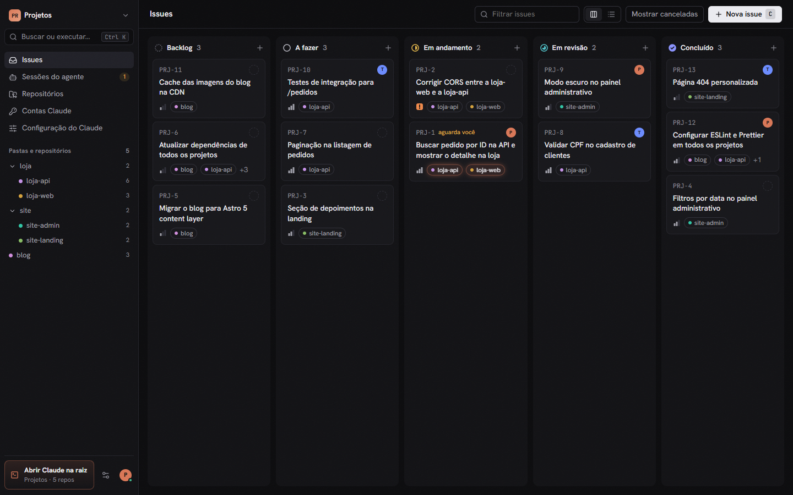
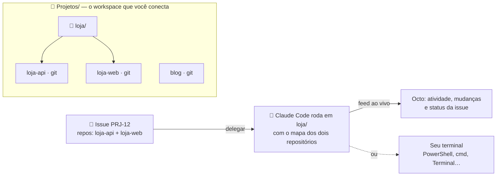
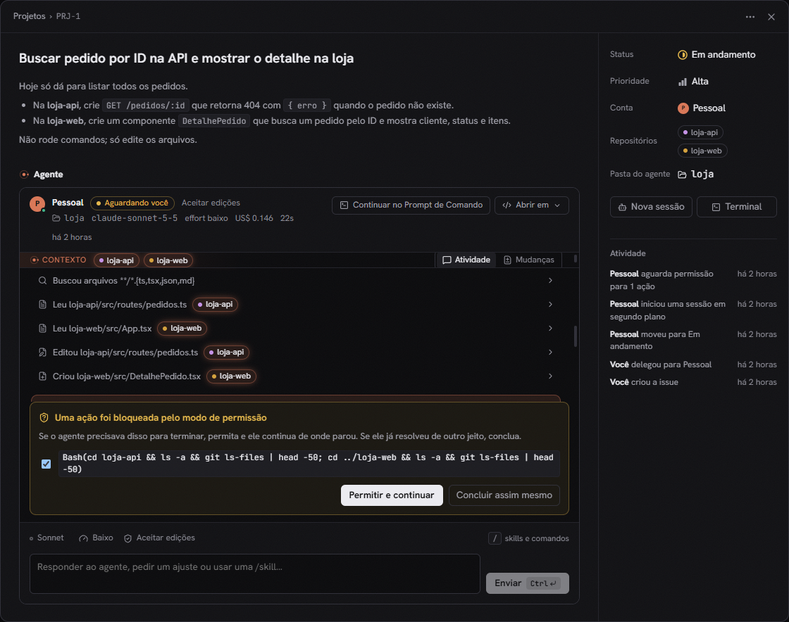
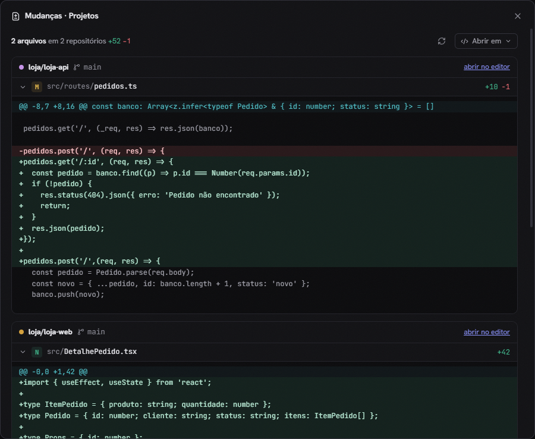

<p align="center">
  
</p>

<h1 align="center">Octo</h1>

<h3 align="center">Um Claude, todos os seus repositórios.</h3>

<p align="center">
  O Octo transforma a pasta onde ficam seus projetos num quadro de issues no estilo <a href="https://linear.app">Linear</a>.<br>
  Você delega uma issue e o <a href="https://docs.claude.com/en/docs/claude-code/overview">Claude Code</a> trabalha na pasta certa, com o contexto<br>
  de todos os repositórios envolvidos — no app ou no seu próprio terminal.
</p>

<p align="center">
  <a href="https://github.com/KazuoMurakami/octo-desktop/releases/latest"></a>
  <a href="https://github.com/KazuoMurakami/octo-desktop/releases"></a>
  <a href="https://github.com/KazuoMurakami/octo-desktop/actions/workflows/ci.yml"></a>
  
  <a href="LICENSE"></a>
</p>

<p align="center">
  <a href="https://github.com/KazuoMurakami/octo-desktop/releases/latest/download/Octo-Setup.exe"></a>
  <a href="https://github.com/KazuoMurakami/octo-desktop/releases/latest/download/Octo-mac-arm64.dmg"></a>
  <a href="https://github.com/KazuoMurakami/octo-desktop/releases/latest/download/Octo-mac-x64.dmg"></a>
  <a href="https://github.com/KazuoMurakami/octo-desktop/releases/latest/download/Octo-linux-x64.deb"></a>
</p>

<p align="center">
  
</p>

---

## Por que o Octo?

Se você tem uma pasta `loja/` com a `loja-api` e a `loja-web` dentro, o jeito mais rápido de dar ao Claude o contexto dos dois é abrir a pasta e rodar `claude` ali. Funciona muito bem, até você ter dez frentes abertas, mais de uma conta e nenhuma ideia do que cada sessão mudou.

O Octo organiza exatamente esse fluxo:

- 🗂️ **Uma pasta, todos os repositórios.** Conecte a pasta dos seus projetos e o Octo encontra cada repositório git, inclusive os agrupados em subpastas.
- 🎯 **Issues que viram prompts.** Título, descrição e repositórios da issue vão direto para o Claude, com status, prioridade e quadro no estilo Linear.
- 🐙 **O agente na pasta certa.** Uma issue que envolve `loja-api` e `loja-web` roda em `loja/`, a menor pasta que contém os dois, com o mapa dos repositórios no contexto. Dispensa um Claude por repo.
- 👀 **No app ou no seu terminal.** Acompanhe pensamentos, ferramentas e resposta ao vivo na issue, ou abra a conversa no PowerShell, no Prompt de Comando, no Terminal do macOS ou no seu emulador do Linux.
- 🧾 **Veja o que mudou.** A aba **Mudanças** mostra o diff de cada repositório tocado pelo agente, e **Abrir em…** leva tudo para o VS Code, Cursor, Windsurf ou Zed.
- 👥 **Várias contas.** Pessoal, trabalho, cliente: cada conta do Claude Code tem seu próprio login e configuração, e cada issue escolhe a sua.
- ⚙️ **Toda a configuração do CLI.** Modelo, effort, permissões, skills, agentes, comandos, servidores MCP, plugins e o `settings.json` inteiro, sem sair do app.
- 🔒 **Local e privado.** Tudo roda na sua máquina. Sem conta no Octo, sem telemetria, sem servidor remoto.

## Como funciona



O Octo não substitui o Claude Code: ele usa o `claude` que já está instalado e logado na sua máquina, com as suas contas, e organiza o trabalho em volta dele.

<p align="center">
  
  
</p>

## Instalação

### Requisitos

- **Claude Code** instalado e logado no mesmo sistema do Octo: rode `claude` uma vez no terminal ([como instalar](https://docs.claude.com/en/docs/claude-code/setup)). No Windows, instale no próprio Windows; um Claude Code que existe só dentro do WSL não é encontrado. Se o Octo não achar o Claude Code, a tela inicial mostra como instalar.
- **Uma conta com acesso ao Claude Code** (Pro, Max, Team, Enterprise ou créditos de API). Cada sessão do Octo consome a cota dessa conta, como o `claude` no seu terminal.
- **git** 2.31 ou mais novo ([download](https://git-scm.com/downloads)). No macOS ele vem com `xcode-select --install` ou com o Homebrew; sem ele, o macOS mostra um aviso pedindo para instalar as ferramentas de desenvolvedor na primeira busca de repositórios.

| Sistema | Download | Situação | Observação |
| --- | --- | --- | --- |
| Windows 10 e 11 (x64) | [`Octo-Setup.exe`](https://github.com/KazuoMurakami/octo-desktop/releases/latest/download/Octo-Setup.exe) | testado | Instala só para o seu usuário, sem pedir administrador. |
| macOS 13 ou mais novo, Apple Silicon | [`Octo-mac-arm64.dmg`](https://github.com/KazuoMurakami/octo-desktop/releases/latest/download/Octo-mac-arm64.dmg) | beta | Arraste para Aplicativos e veja a [primeira abertura](#primeira-abertura). |
| macOS 13 ou mais novo, Intel | [`Octo-mac-x64.dmg`](https://github.com/KazuoMurakami/octo-desktop/releases/latest/download/Octo-mac-x64.dmg) | beta | Arraste para Aplicativos e veja a [primeira abertura](#primeira-abertura). |
| Ubuntu, Debian e derivados (x64) | [`Octo-linux-x64.deb`](https://github.com/KazuoMurakami/octo-desktop/releases/latest/download/Octo-linux-x64.deb) | beta | `sudo apt install ./Octo-linux-x64.deb` (o recomendado no Linux). |
| Outras distros (x64) | [`Octo-linux-x64.AppImage`](https://github.com/KazuoMurakami/octo-desktop/releases/latest/download/Octo-linux-x64.AppImage) | beta | Precisa do FUSE 2; veja abaixo. |

**Beta** quer dizer que o instalador passa pelo autoteste automático a cada versão, mas ainda não foi usado no dia a dia nesse sistema. Se algo não funcionar, [conte numa issue](https://github.com/KazuoMurakami/octo-desktop/issues/new?template=bug_report.yml) qual é o seu sistema: é assim que o beta sai.

### Primeira abertura

Os instaladores ainda não têm assinatura digital paga, então o sistema avisa na primeira vez. Se quiser, [confira o download](#verificando-o-download) antes.

**Windows.** O SmartScreen mostra "O Windows protegeu o computador". Clique em **Mais informações → Executar assim mesmo**.

**macOS.** O app tem assinatura ad-hoc, mas não é notarizado pela Apple, e o macOS bloqueia a primeira abertura:

1. Abra o `.dmg` e **arraste o Octo para Aplicativos**. Não abra direto do `.dmg`.
2. Abra o Octo. No aviso de que a Apple não pôde verificá-lo, clique em **Concluído** (não em "Mover para o Lixo").
3. Vá em **Ajustes do Sistema → Privacidade e Segurança**, role até **Segurança** e clique em **Abrir Mesmo Assim**. Confirme com sua senha. O botão fica ali por cerca de uma hora depois da tentativa, e só é preciso fazer isso uma vez.

No macOS 14 ou anterior, também funciona clicar com o botão direito no Octo em Aplicativos e escolher **Abrir**. Se nada disso aparecer, rode no Terminal, depois de conferir o checksum: `xattr -dr com.apple.quarantine /Applications/Octo.app`.

Se você escolher o iTerm2 em **Preferências**, o macOS pergunta se o Octo pode controlá-lo (permissão de Automação). Como o app não tem assinatura da Apple, esse pedido pode voltar depois de uma atualização.

**Linux.** Prefira o `.deb`: no Ubuntu 24.04 ou mais novo, ele instala o perfil do AppArmor que mantém o sandbox do Chromium ligado. Para o AppImage:

```bash
chmod +x Octo-linux-x64.AppImage
./Octo-linux-x64.AppImage
```

Se aparecer "AppImages require FUSE to run", instale o FUSE 2: `sudo apt install libfuse2t64` no Ubuntu 24.04 ou mais novo, `sudo apt install libfuse2` no 22.04. **Não instale o pacote `fuse`**, que pode quebrar o sistema. Sem FUSE, dá para rodar com `./Octo-linux-x64.AppImage --appimage-extract-and-run`. No Ubuntu 24.04 ou mais novo o AppImage abre sem o sandbox do Chromium, e por isso o `.deb` é o recomendado.

Cada instalador é gerado pelo GitHub Actions a partir do código deste repositório. Antes de entrar na release, ele passa por um autoteste no próprio sistema (o do Mac Intel roda no Rosetta, num Mac com Apple Silicon): o app abre, a API recusa acesso sem o token, a interface carrega na janela e o executável é conferido (fuses do Electron e, no macOS, a assinatura).

### Verificando o download

Cada release traz o `SHA256SUMS.txt` e uma atestação de proveniência assinada pelo GitHub (`Octo-vX.Y.Z.sigstore.json`), que prova que o instalador saiu do workflow deste repositório:

```bash
# confere o checksum (Linux)
sha256sum --check --ignore-missing SHA256SUMS.txt

# confere o checksum (macOS)
shasum -a 256 --check --ignore-missing SHA256SUMS.txt

# confere a origem do arquivo (GitHub CLI; com o .sigstore.json da release, não precisa de login)
gh attestation verify Octo-Setup.exe --repo KazuoMurakami/octo-desktop --bundle Octo-v0.1.0.sigstore.json
```

No Windows, rode `Get-FileHash .\Octo-Setup.exe` no PowerShell e compare com a linha do arquivo em `SHA256SUMS.txt`. Mais detalhes em [docs/instalacao.md](docs/instalacao.md).

## Primeiros passos

1. **Conecte a pasta** onde ficam seus projetos. O Octo lista os repositórios encontrados antes de você confirmar.
2. **Crie uma issue** (`C`) e marque os repositórios envolvidos. A descrição vira o prompt do Claude.
3. **Delegue.** Escolha a conta, o modelo, o effort e as permissões, e decida entre segundo plano e terminal.
4. **Revise.** Veja o diff na aba **Mudanças**, abra no editor com **Abrir em…**, responda ao agente pela própria issue ou continue a conversa no terminal.

Atalhos: `C` cria uma issue, `Ctrl K` (`⌘ K` no macOS) abre a paleta de comandos, `Esc` fecha painéis e `Ctrl V` (`⌘ V`) anexa um print à resposta ao agente (com texto copiado junto, use `Alt V` ou `⌥ V`). O botão direito (ou `Shift F10` no item focado) num card, repositório, pasta ou sessão mostra as ações dele: mudar status e prioridade, abrir no editor ou no terminal, copiar o caminho ou o identificador, excluir. No app desktop, o menu **Ajuda** leva à documentação, mostra a versão e abre um relato de problema já preenchido.

## Trabalhe do seu jeito

- **Terminal do sistema.** Em **Preferências** você escolhe onde o Claude abre: Prompt de Comando, Windows PowerShell ou PowerShell 7 no Windows (a janela abre no seu app de terminal padrão, como o Windows Terminal), Terminal ou iTerm2 no macOS, e o emulador instalado no Linux. **Continuar no terminal** retoma a mesma conversa (`claude --resume`) com a mesma conta e as mesmas opções, e **Terminal aqui** abre só o shell na pasta.
- **Editor.** **Abrir em…** abre a pasta no VS Code, Cursor, Windsurf ou Zed. Quando a sessão envolve vários repositórios, o Octo cria um workspace com todos eles, e o painel de controle de versão do editor mostra as mudanças de cada um.
- **Mudanças.** A aba **Mudanças** de cada sessão mostra o que está diferente do último commit em cada repositório, inclusive arquivos novos. Também dá para ver as mudanças de qualquer repositório ou pasta em **Repositórios**.
- **Imagens.** Cole um print, arraste ou anexe imagens na resposta ao agente ou ao delegar em segundo plano: elas vão para o Claude junto com a mensagem e ficam como miniaturas no feed da sessão.
- **Worktrees.** Com **Trabalhar num worktree** marcado ao delegar, a issue ganha uma pasta própria em `~/.octo/worktrees` (ex.: `~/.octo/worktrees/projetos/prj-12`), com um worktree git de cada repositório dela numa branch curta, a mesma em todos (ex.: `prj-12-checkout-pix`). A branch sai da branch padrão, atualizada com `git fetch`, ou da branch atual, e as próximas sessões da issue continuam no mesmo worktree. Arquivos fora do git listados no `.worktreeinclude` do repositório, como o `.env`, vão junto, como no Claude Code. Remover o worktree (no menu da issue) apaga a pasta; as branches e os commits ficam nos repositórios.

No macOS e no Linux, o app desktop carrega o ambiente do seu shell de login (PATH, chaves e variáveis do Claude Code, proxy, AWS etc.), então as sessões em segundo plano enxergam o mesmo ambiente do seu terminal.

## Contas e configuração do Claude

Cada conta é um `CLAUDE_CONFIG_DIR` separado, com login, histórico e configurações isolados. A conta **Principal** usa o seu `~/.claude` de sempre, e **Contas Claude → Adicionar conta** cria outras (pessoal, trabalho, cliente), por padrão em pastas `~/.claude-<nome>`, e abre o login de cada uma.

Em **Configuração do Claude**, cada conta tem:

- **Geral:** modelo, effort e pensamento estendido padrão.
- **Skills, Agentes e Comandos:** criar, editar, copiar para outra conta e excluir (vai para uma lixeira em `~/.octo/trash`).
- **MCP:** servidores de escopo `user`, adicionados e removidos com o próprio `claude mcp`.
- **Plugins:** instalar, ativar, desativar e desinstalar com `claude plugin`.
- **settings.json:** o arquivo inteiro, com validação e cópia da versão anterior em `~/.octo/backups`.

Em cada sessão dá para ajustar as mesmas opções do CLI: modelo (`--model`), effort (`--effort`), permissões (`--permission-mode`), agente principal (`--agent`), modelo reserva (`--fallback-model`), pastas extras (`--add-dir`) e orçamento (`--max-budget-usd`). Na caixa de resposta, `/` lista suas skills e comandos.

<details>
<summary><b>Do Linear para o Octo</b></summary>

| Linear | Octo |
| --- | --- |
| Workspace | Uma pasta local com seus repositórios (profundidade de busca configurável) |
| Teams e projects | Repositórios e pastas de grupo |
| Issue, status, prioridade, `PRJ-12` | Igual, com quadro de arrastar e soltar e lista |
| Delegar a um agente | Delegar a uma conta do Claude: a issue vai para *Em andamento* e, quando o agente termina, para *Em revisão* |
| Agent session | Feed ao vivo: raciocínio, ferramentas, repositórios tocados e resposta |
| Elicitation | Quando o modo de permissão bloqueia algo, a issue mostra o pedido e **Permitir e continuar** retoma a sessão |
| Agent guidance | Diretrizes do workspace, que vão para o system prompt e para o `CLAUDE.md` gerado |

</details>

## Privacidade e segurança

- **Tudo local.** Workspaces, issues e sessões ficam em `~/.octo`. O Octo não tem conta, telemetria nem analytics. A única conexão que ele faz por conta própria é consultar a página de releases do GitHub, no máximo a cada 6 horas, para avisar de versões novas (dá para desligar em **Preferências**). Fora isso, só o git, ao criar um worktree a partir da branch padrão: ele consulta e atualiza essa branch no remoto `origin` (`git ls-remote` e `git fetch`) com as credenciais que já usa, sem abrir pedido de senha.
- **Login do Claude.** O Octo não lê o login do Claude Code (o `.credentials.json` ou o Keychain do macOS): quem fala com a Anthropic é o próprio Claude Code.
- **settings.json.** O Octo lê e edita o `settings.json` de cada conta quando você usa **Configuração do Claude**, e guarda a versão anterior em `~/.octo/backups`. Se você guarda chaves nesse arquivo (no bloco `env`, como `ANTHROPIC_API_KEY`), elas aparecem nessa tela e ficam nos backups. Ao criar uma conta copiando as preferências da principal, as chaves conhecidas (Anthropic, AWS, `apiKeyHelper`) ficam de fora; detalhes em [Dados e privacidade](docs/dados-e-privacidade.md).
- **API protegida.** O servidor interno escuta só em `127.0.0.1`, exige um token guardado em `~/.octo/token` (legível só pelo seu usuário) e recusa requisições de outros sites.
- **App isolado.** A janela roda em sandbox, nega pedidos de câmera, microfone e localização e abre links externos no navegador. O executável vem com os fuses de segurança do Electron conferidos a cada release. Detalhes no [SECURITY.md](SECURITY.md).
- **Seus repositórios.** O Octo não escreve neles. Quem altera arquivos é o Claude, dentro das permissões que você escolher, e o `CLAUDE.md` de contexto só é gravado quando você pede. A exceção são os worktrees: com **Trabalhar num worktree**, o Octo roda `git fetch` (para partir da versão mais recente da branch padrão) e `git worktree` em cada repositório da issue, o que cria uma branch e um worktree para ela. Ele nunca faz commit nem push, e remover o worktree mantém a branch.
- **Cuidado com "Sem restrições".** Esse modo (`bypassPermissions`) deixa o agente rodar qualquer comando. Use só em pastas descartáveis.

Encontrou uma falha? Veja o [SECURITY.md](SECURITY.md) para reportar em privado. Mais detalhes sobre o que fica onde em [docs/dados-e-privacidade.md](docs/dados-e-privacidade.md).

## Perguntas frequentes

<details>
<summary><b>O Octo usa a minha assinatura do Claude?</b></summary>

Sim. Ele chama o Claude Code oficial com a conta que você escolher, então vale o mesmo plano (Pro, Max, Team, Enterprise ou créditos de API) e os mesmos limites de uso. Cada sessão consome a cota dessa conta como se você rodasse `claude` no terminal, e várias sessões em segundo plano ao mesmo tempo consomem em paralelo. Com créditos de API, o campo **Orçamento** (`--max-budget-usd`) limita o gasto de cada sessão. O Octo em si é gratuito.
</details>

<details>
<summary><b>Preciso deixar o Octo aberto para o agente trabalhar?</b></summary>

Para sessões em segundo plano, sim: ao fechar o app, ele pergunta antes de interromper agentes em andamento. Sessões abertas no terminal continuam rodando normalmente.
</details>

<details>
<summary><b>Já uso o Claude no terminal. O Octo atrapalha?</b></summary>

Não. Ele só organiza e abre o mesmo `claude`. Uma sessão pode ir do app para o terminal e voltar: **Continuar no terminal** retoma a conversa e **Sincronizar** traz o andamento de volta para a issue.
</details>

<details>
<summary><b>O Octo não encontra o Claude Code no Windows, mas eu uso no WSL.</b></summary>

O Octo roda no Windows e procura o Claude Code instalado no próprio Windows. Instale com o instalador oficial para Windows (veja a tela inicial do Octo ou a [documentação do Claude Code](https://docs.claude.com/en/docs/claude-code/setup)) e faça o login uma vez no PowerShell. Se ele estiver num lugar fora do comum, aponte com a variável `OCTO_CLAUDE_BIN`.
</details>

<details>
<summary><b>Funciona com monorepo?</b></summary>

Sim. Um monorepo é um repositório só; o Octo brilha quando há vários repositórios lado a lado, mas funciona igual com um.
</details>

<details>
<summary><b>Por que macOS e Linux estão em beta?</b></summary>

Os instaladores de macOS e Linux são gerados e testados automaticamente a cada versão (o app abre, protege a API e carrega a interface), mas ainda não foram usados no dia a dia nesses sistemas. As partes que mais dependem do sistema são abrir o terminal e o editor. Se algo falhar, uma issue com o seu sistema ajuda muito.
</details>

<details>
<summary><b>Como atualizo?</b></summary>

Quando sai uma versão nova, o Octo avisa na barra lateral. Baixe o instalador e rode por cima do atual: o programa é substituído e seus dados em `~/.octo` continuam onde estão.
</details>

<details>
<summary><b>Onde ficam os dados e como desinstalar?</b></summary>

Para tirar só uma pasta do Octo, use **Desconectar esta pasta…** no seletor de pastas, no topo da barra lateral: as issues e as sessões dela saem do Octo, e nada é apagado do disco.

Desinstale pelo sistema: **Configurações → Aplicativos** no Windows, arrastar o Octo de Aplicativos para o Lixo no macOS, `sudo apt remove octo` no Linux (o AppImage é só apagar o arquivo). Isso remove o programa, mas mantém seus dados. Para remover tudo, apague também:

- `~/.octo` (no Windows, `C:\Users\<você>\.octo`): workspaces, issues, sessões, as imagens das conversas (`images/`), os worktrees das issues (`worktrees/`), backups e o token da API. Um worktree pode ter trabalho sem commit: remova cada um antes, no painel da issue (**Mais ações → Remover worktree…**), que mostra o que se perde. Se apagar a pasta direto, o git ainda lembra desses worktrees: em cada repositório, `git worktree list` mostra os que ficaram, e `git worktree remove --force <caminho>` faz o git esquecer cada um (as branches das issues continuam). Evite o `git worktree prune` sem antes conferir com `git worktree prune --dry-run -v`: ele também esquece worktrees seus que estejam, por exemplo, num disco desconectado.
- A pasta do app: `%APPDATA%\Octo` no Windows, `~/Library/Application Support/Octo` no macOS, `~/.config/Octo` no Linux (cache da janela).
- As pastas `~/.claude-<nome>` das contas extras que você criou pelo Octo, se não quiser mais essas contas. Elas guardam o login, o histórico e a configuração delas, e o Octo não as apaga nem quando você remove a conta no app.
- Se você gerou `CLAUDE.md` pelo Octo, o bloco entre `<!-- octo:workspace:start -->` e `<!-- octo:workspace:end -->` nesses arquivos.

A conta **Principal** usa o seu `~/.claude` de sempre, que continua sendo do Claude Code.
</details>

## Rodando a partir do código

Requer Node.js 22.18 ou mais novo.

```bash
git clone https://github.com/KazuoMurakami/octo-desktop.git
cd octo-desktop
npm install
npm start           # interface no navegador
npm run desktop     # o app desktop (Electron)
npm run dist        # gera o instalador do seu sistema em release/
```

Variáveis opcionais: `OCTO_PORT` (padrão 4317), `OCTO_DATA_DIR` (padrão `~/.octo`), `OCTO_CLAUDE_BIN` (caminho do executável do Claude Code) e `OCTO_DEVTOOLS=1` (mostra as ferramentas de desenvolvedor no app desktop). No Linux, o `npm start` usa o `zenity` para o seletor de pastas; sem ele, digite o caminho. Para contribuir, veja o [CONTRIBUTING.md](CONTRIBUTING.md) e a pasta [docs/](docs/README.md).

## Licença

O código é livre sob a [licença MIT](LICENSE). Os instaladores levam também os avisos de licença das bibliotecas que vão junto (na pasta `resources/licenses` do app). O nome **Octo** e o logotipo do polvo são reservados; veja o [TRADEMARK.md](TRADEMARK.md).

O Octo é um projeto independente, sem vínculo com a Anthropic ou com a Linear. Claude e Claude Code são marcas da Anthropic.

---

<details>
<summary>🇺🇸 <b>In English</b></summary>

**Octo** turns the folder where your projects live into a Linear-style issue board for [Claude Code](https://docs.claude.com/en/docs/claude-code/overview). Connect a folder with several git repositories, create an issue, tag the repositories involved and delegate it: Claude Code runs in the smallest folder that contains all of them, with a map of every repository in context. Follow the agent live in the app, or continue the same conversation in your own terminal (PowerShell, cmd, Terminal, iTerm2, Linux emulators). Review the diff in the **Changes** tab, open everything in VS Code, Cursor, Windsurf or Zed, and manage multiple Claude accounts plus their full CLI configuration (model, effort, skills, agents, MCP servers, plugins, `settings.json`).

Everything runs locally: no account, no telemetry. Requires Claude Code installed and signed in on the same OS (on Windows, a WSL-only install is not detected); sessions use your Claude plan's quota like `claude` in a terminal. Windows is tested; macOS and Linux builds pass an automated self-test on every release but are still beta. The macOS app is ad-hoc signed, not notarized: after the first launch attempt, allow it in System Settings → Privacy & Security → Open Anyway. The UI is currently in Brazilian Portuguese. [Download the latest release](https://github.com/KazuoMurakami/octo-desktop/releases/latest).
</details>
