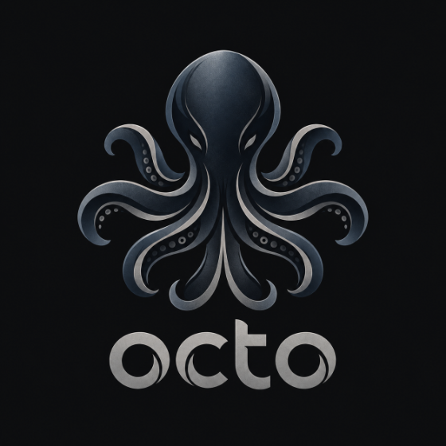
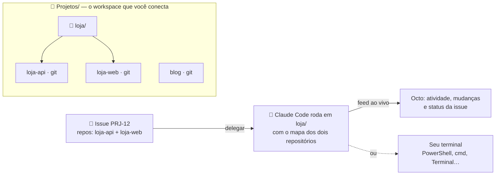

<p align="center">
  
</p>

<h3 align="center">Um Claude, todos os seus repositórios.</h3>

<p align="center">
  O Octo transforma a pasta onde ficam seus projetos num quadro de issues no estilo <a href="https://linear.app">Linear</a>.<br>
  Você delega uma issue e o <a href="https://docs.claude.com/en/docs/claude-code/overview">Claude Code</a> trabalha na pasta certa, com o contexto<br>
  de todos os repositórios envolvidos — no app ou no seu próprio terminal.
</p>

<p align="center">
  <a href="https://github.com/KazuoMurakami/octo-desktop/releases/latest"></a>
  <a href="https://github.com/KazuoMurakami/octo-desktop/releases"></a>
  <a href="https://github.com/KazuoMurakami/octo-desktop/actions/workflows/ci.yml"></a>
  
  <a href="LICENSE"></a>
</p>

<p align="center">
  <a href="https://github.com/KazuoMurakami/octo-desktop/releases/latest/download/Octo-Setup.exe"></a>
  <a href="https://github.com/KazuoMurakami/octo-desktop/releases/latest/download/Octo-mac-arm64.dmg"></a>
  <a href="https://github.com/KazuoMurakami/octo-desktop/releases/latest/download/Octo-mac-x64.dmg"></a>
  <a href="https://github.com/KazuoMurakami/octo-desktop/releases/latest/download/Octo-linux-x64.deb"></a>
</p>

---

## Por que o Octo?

Se você tem uma pasta `loja/` com a `loja-api` e a `loja-web` dentro, o jeito mais rápido de dar ao Claude o contexto dos dois é abrir a pasta e rodar `claude` ali. Funciona muito bem, até você ter dez frentes abertas, mais de uma conta e nenhuma ideia do que cada sessão mudou.

O Octo organiza exatamente esse fluxo:

- 🗂️ **Uma pasta, todos os repositórios.** Conecte a pasta dos seus projetos e o Octo encontra cada repositório git, inclusive os agrupados em subpastas.
- 🎯 **Issues que viram prompts.** Título, descrição e repositórios da issue vão direto para o Claude, com status, prioridade e quadro no estilo Linear.
- 🐙 **O agente na pasta certa.** Uma issue que envolve `loja-api` e `loja-web` roda em `loja/`, a menor pasta que contém os dois, com o mapa dos repositórios no contexto. Dispensa um Claude por repo.
- 👀 **No app ou no seu terminal.** Acompanhe pensamentos, ferramentas e resposta ao vivo na issue, ou abra a conversa no PowerShell, no Prompt de Comando, no Terminal do macOS ou no seu emulador do Linux.
- 🧾 **Veja o que mudou.** A aba **Mudanças** mostra o diff de cada repositório tocado pelo agente, e **Abrir em…** leva tudo para o VS Code, Cursor, Windsurf ou Zed.
- 👥 **Várias contas.** Pessoal, trabalho, cliente: cada conta do Claude Code tem seu próprio login e configuração, e cada issue escolhe a sua.
- ⚙️ **Toda a configuração do CLI.** Modelo, effort, permissões, skills, agentes, comandos, servidores MCP, plugins e o `settings.json` inteiro, sem sair do app.
- 🔒 **Local e privado.** Tudo roda na sua máquina. Sem conta no Octo, sem telemetria, sem servidor remoto.

## Como funciona



O Octo não substitui o Claude Code: ele usa o `claude` que já está instalado e logado na sua máquina, com as suas contas, e organiza o trabalho em volta dele.

## Instalação

**Requisitos:** o [Claude Code](https://docs.claude.com/en/docs/claude-code/setup) instalado e logado (rode `claude` uma vez no terminal) e o [git](https://git-scm.com/downloads). Se o Octo não encontrar o Claude Code, a tela inicial mostra como instalar.

| Sistema | Download | Observação |
| --- | --- | --- |
| Windows 10 e 11 | [`Octo-Setup.exe`](https://github.com/KazuoMurakami/octo-desktop/releases/latest/download/Octo-Setup.exe) | Instala só para o seu usuário, sem pedir administrador. |
| macOS (Apple Silicon) | [`Octo-mac-arm64.dmg`](https://github.com/KazuoMurakami/octo-desktop/releases/latest/download/Octo-mac-arm64.dmg) | Arraste para Aplicativos. |
| macOS (Intel) | [`Octo-mac-x64.dmg`](https://github.com/KazuoMurakami/octo-desktop/releases/latest/download/Octo-mac-x64.dmg) | Arraste para Aplicativos. |
| Linux (Debian, Ubuntu) | [`Octo-linux-x64.deb`](https://github.com/KazuoMurakami/octo-desktop/releases/latest/download/Octo-linux-x64.deb) | `sudo apt install ./Octo-linux-x64.deb` |
| Linux (outras distros) | [`Octo-linux-x64.AppImage`](https://github.com/KazuoMurakami/octo-desktop/releases/latest/download/Octo-linux-x64.AppImage) | `chmod +x` e execute. Precisa do `libfuse2`. |

### Primeira abertura

Os instaladores ainda não têm assinatura digital paga, então o sistema avisa na primeira vez:

- **Windows:** o SmartScreen mostra "O Windows protegeu o computador". Clique em **Mais informações → Executar assim mesmo**.
- **macOS:** clique com o botão direito no Octo em Aplicativos e escolha **Abrir**. Se aparecer "está danificado e não pode ser aberto", rode `xattr -dr com.apple.quarantine /Applications/Octo.app` no Terminal.
- **Linux (AppImage):** se não abrir, instale o FUSE 2 (`sudo apt install libfuse2t64` no Ubuntu 24.04, `libfuse2` nas versões anteriores) ou use o `.deb`.

Todo instalador é gerado pelo GitHub Actions a partir do código deste repositório e testado automaticamente antes de ser publicado.

### Verificando o download

Cada release traz o arquivo `SHA256SUMS.txt` e uma atestação de proveniência assinada pelo GitHub, que prova que o instalador saiu deste repositório:

```bash
# confere o checksum (Linux e macOS)
shasum -a 256 -c SHA256SUMS.txt --ignore-missing

# confere a origem do arquivo (precisa do GitHub CLI)
gh attestation verify Octo-Setup.exe --repo KazuoMurakami/octo-desktop
```

No Windows, o checksum sai com `Get-FileHash .\Octo-Setup.exe -Algorithm SHA256` no PowerShell.

## Primeiros passos

1. **Conecte a pasta** onde ficam seus projetos. O Octo lista os repositórios encontrados antes de você confirmar.
2. **Crie uma issue** (`C`) e marque os repositórios envolvidos. A descrição vira o prompt do Claude.
3. **Delegue.** Escolha a conta, o modelo, o effort e as permissões, e decida entre segundo plano e terminal.
4. **Revise.** Veja o diff na aba **Mudanças**, abra no editor com **Abrir em…**, responda ao agente pela própria issue ou continue a conversa no terminal.

Atalhos: `C` cria uma issue, `Ctrl K` (ou `⌘ K`) abre a paleta de comandos, `Esc` fecha painéis.

## Trabalhe do seu jeito

- **Terminal do sistema.** Em **Preferências** você escolhe onde o Claude abre: Prompt de Comando, Windows PowerShell ou PowerShell 7 no Windows (a janela abre no seu app de terminal padrão, como o Windows Terminal), Terminal ou iTerm2 no macOS, e o emulador instalado no Linux. **Continuar no terminal** retoma a mesma conversa (`claude --resume`) com a mesma conta e as mesmas opções, e **Terminal aqui** abre só o shell na pasta.
- **Editor.** **Abrir em…** abre a pasta no VS Code, Cursor, Windsurf ou Zed. Quando a sessão envolve vários repositórios, o Octo cria um workspace com todos eles, e o painel de controle de versão do editor mostra as mudanças de cada um.
- **Mudanças.** A aba **Mudanças** de cada sessão mostra o que está diferente do último commit em cada repositório, inclusive arquivos novos. Também dá para ver as mudanças de qualquer repositório ou pasta em **Repositórios**.

## Contas e configuração do Claude

Cada conta é um `CLAUDE_CONFIG_DIR` separado, com login, histórico e configurações isolados. A conta **Principal** usa o seu `~/.claude` de sempre, e **Contas Claude → Adicionar conta** cria outras (pessoal, trabalho, cliente) e abre o login de cada uma.

Em **Configuração do Claude**, cada conta tem:

- **Geral:** modelo, effort e pensamento estendido padrão.
- **Skills, Agentes e Comandos:** criar, editar, copiar para outra conta e excluir (vai para uma lixeira em `~/.octo/trash`).
- **MCP:** servidores de escopo `user`, adicionados e removidos com o próprio `claude mcp`.
- **Plugins:** instalar, ativar, desativar e desinstalar com `claude plugin`.
- **settings.json:** o arquivo inteiro, com validação e backup automático da versão anterior.

Em cada sessão dá para ajustar as mesmas opções do CLI: modelo (`--model`), effort (`--effort`), permissões (`--permission-mode`), agente principal (`--agent`), modelo reserva (`--fallback-model`), pastas extras (`--add-dir`) e orçamento (`--max-budget-usd`). Na caixa de resposta, `/` lista suas skills e comandos.

<details>
<summary><b>Do Linear para o Octo</b></summary>

| Linear | Octo |
| --- | --- |
| Workspace | Uma pasta local com seus repositórios (profundidade de busca configurável) |
| Teams e projects | Repositórios e pastas de grupo |
| Issue, status, prioridade, `PRJ-12` | Igual, com quadro de arrastar e soltar e lista |
| Delegar a um agente | Delegar a uma conta do Claude: a issue vai para *Em andamento* e, quando o agente termina, para *Em revisão* |
| Agent session | Feed ao vivo: raciocínio, ferramentas, repositórios tocados e resposta |
| Elicitation | Quando o modo de permissão bloqueia algo, a issue mostra o pedido e **Permitir e continuar** retoma a sessão |
| Agent guidance | Diretrizes do workspace, que vão para o system prompt e para o `CLAUDE.md` gerado |

</details>

## Privacidade e segurança

- **Tudo local.** Workspaces, issues e sessões ficam em `~/.octo`. O Octo não tem conta, telemetria nem analytics. A única conexão que ele faz por conta própria é consultar a página de releases do GitHub, no máximo a cada 6 horas, para avisar de versões novas (dá para desligar em **Preferências**).
- **Sem credenciais.** O Octo nunca lê nem copia o login do Claude: quem fala com a Anthropic é o próprio Claude Code.
- **API protegida.** O servidor interno escuta só em `127.0.0.1`, exige um token guardado em `~/.octo/token` (legível só pelo seu usuário) e recusa requisições de outros sites.
- **Seus repositórios.** O Octo não escreve neles. Quem altera arquivos é o Claude, dentro das permissões que você escolher, e o `CLAUDE.md` de contexto só é gravado quando você pede.
- **Cuidado com "Sem restrições".** Esse modo (`bypassPermissions`) deixa o agente rodar qualquer comando. Use só em pastas descartáveis.

Encontrou uma falha? Veja o [SECURITY.md](SECURITY.md) para reportar em privado.

## Perguntas frequentes

<details>
<summary><b>O Octo usa a minha assinatura do Claude?</b></summary>

Sim. Ele chama o Claude Code oficial com a conta que você escolher, então vale o mesmo plano (Pro, Max, Team ou chave de API) e os mesmos limites de uso. O Octo em si é gratuito.
</details>

<details>
<summary><b>Preciso deixar o Octo aberto para o agente trabalhar?</b></summary>

Para sessões em segundo plano, sim: ao fechar o app, ele pergunta antes de interromper agentes em andamento. Sessões abertas no terminal continuam rodando normalmente.
</details>

<details>
<summary><b>Já uso o Claude no terminal. O Octo atrapalha?</b></summary>

Não. Ele só organiza e abre o mesmo `claude`. Uma sessão pode ir do app para o terminal e voltar: **Continuar no terminal** retoma a conversa e **Sincronizar** traz o andamento de volta para a issue.
</details>

<details>
<summary><b>Funciona com monorepo?</b></summary>

Sim. Um monorepo é um repositório só; o Octo brilha quando há vários repositórios lado a lado, mas funciona igual com um.
</details>

<details>
<summary><b>Como atualizo?</b></summary>

Quando sai uma versão nova, o Octo avisa na barra lateral. Baixe o instalador e rode por cima do atual: o programa é substituído e seus dados em `~/.octo` continuam onde estão.
</details>

<details>
<summary><b>Onde ficam os dados e como desinstalar?</b></summary>

Os dados ficam em `~/.octo` (no Windows, `C:\Users\<você>\.octo`). Desinstale pelo sistema (Configurações → Aplicativos no Windows, arrastar para o Lixo no macOS, `sudo apt remove octo` no Linux) e apague essa pasta se quiser remover tudo.
</details>

## Rodando a partir do código

Requer Node.js 22.18 ou mais novo.

```bash
git clone https://github.com/KazuoMurakami/octo-desktop.git
cd octo-desktop
npm install
npm start           # interface no navegador
npm run desktop     # o app desktop (Electron)
npm run dist        # gera o instalador do seu sistema em release/
```

Variáveis opcionais: `OCTO_PORT` (padrão 4317), `OCTO_DATA_DIR` (padrão `~/.octo`) e `OCTO_CLAUDE_BIN` (caminho do executável do Claude Code). Para contribuir, veja o [CONTRIBUTING.md](CONTRIBUTING.md).

## Licença

O código é livre sob a [licença MIT](LICENSE). O nome **Octo** e o logotipo do polvo são reservados; veja o [TRADEMARK.md](TRADEMARK.md).

O Octo é um projeto independente, sem vínculo com a Anthropic ou com a Linear. Claude e Claude Code são marcas da Anthropic.

---

<details>
<summary>🇺🇸 <b>In English</b></summary>

**Octo** turns the folder where your projects live into a Linear-style issue board for [Claude Code](https://docs.claude.com/en/docs/claude-code/overview). Connect a folder with several git repositories, create an issue, tag the repositories involved and delegate it: Claude Code runs in the smallest folder that contains all of them, with a map of every repository in context. Follow the agent live in the app, or continue the same conversation in your own terminal (PowerShell, cmd, Terminal, iTerm2, Linux emulators). Review the diff in the **Changes** tab, open everything in VS Code, Cursor, Windsurf or Zed, and manage multiple Claude accounts plus their full CLI configuration (model, effort, skills, agents, MCP servers, plugins, `settings.json`).

Everything runs locally: no account, no telemetry. Requires Claude Code installed and signed in. The UI is currently in Brazilian Portuguese. [Download the latest release](https://github.com/KazuoMurakami/octo-desktop/releases/latest).
</details>
